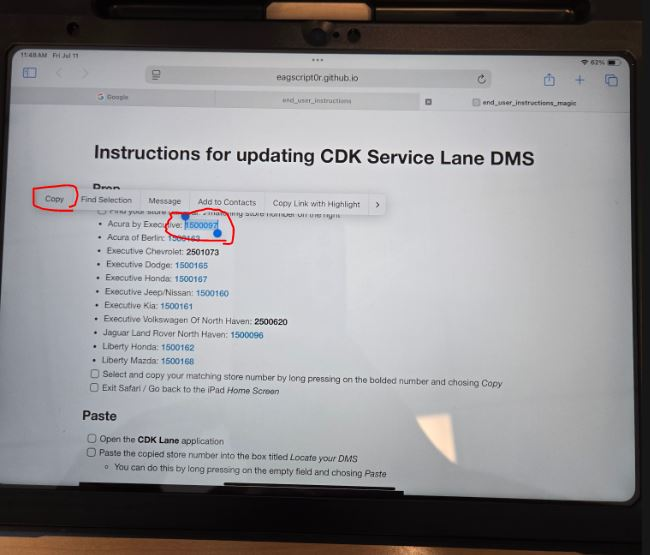
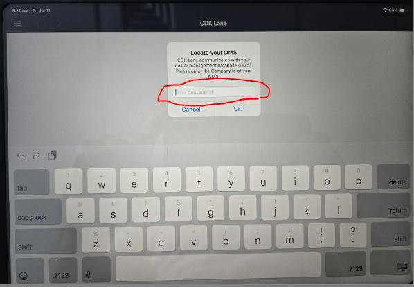

2026-10-15

# CDK Service Mobile Desktop URL

As of 2026.09: Config for iPad app CDK Service Mobile Desktop

- Settings | Apps | CDK Service Mobile Desktop | *Server* : **https://C185978.drive.connectcdk.com/mobile.php/se/device/iPad**

Additional steps that are only need if the above fails

- Settings | Apps | Safari | *Prevent Cross-Site Tracking* : **disabled**
- Settings | Apps | CDK Service Mobile Desktop | *Allow Cross-Site Tracking* : **enabled**

# Deprecated / Do Not Use

---
## Instructions for updating CDK Service Lane DMS

**TLDR:**

- Find your *Store ID Number*
- Start **CDK Lane**
- Put *Store ID Number* in the box
- Click OK

---

## Detailed Instructions

### Find

- [ ] Find your store name and matching *Store ID Number* on the right
  - Acura by Executive: **1500097**
  - Acura of Berlin: **1500163**
  - Executive Chevrolet: **2501073**
  - Executive Dodge: **1500165**
  - Executive Honda: **1500167**
  - Executive Jeep/Nissan: **1500160**
  - Executive Kia: **1500161**
  - Executive Volkswagen Of North Haven: **2500620**
  - Jaguar Land Rover North Haven: **1500096**
  - Liberty Honda: **1500162**
  - Liberty Mazda: **1500168**

### Copy

- [ ] Select and copy your matching *Store ID Number*
  - You can do this by long pressing on the bolded number and chosing *Copy* (see image)  
    
- [ ] After copying the *Store ID Number* you can exit Safari and go back to the iPad *Home Screen*

### Paste

- [ ] Open the **CDK Lane** application
- [ ] Paste the copied *Store ID Number* into the box titled *Locate your DMS*
  - You can do this by long pressing on the empty field and chosing *Paste*

- [ ] After successfully entering the *Store ID Number* , tap OK

### Login

- [ ] Login using your assigned CDK login information
- [ ] Enjoy all that **CDK Lane** has to offer you!  
  
